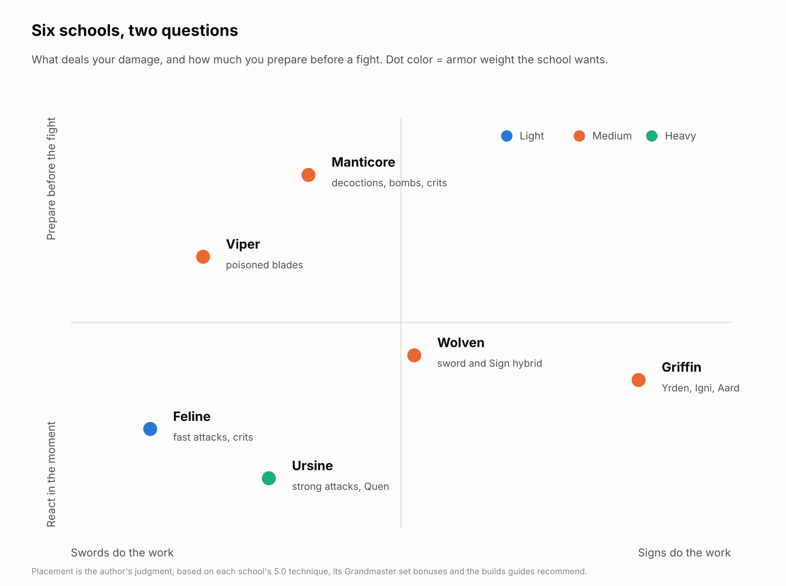

# The Witcher 3 Remastered: Schools, Builds and Gear

*A field guide to patch 5.0*

As of October 9, 2026 · patch 5.0 (Remastered) and 5.01

Patch 5.0 rebuilt how Geralt grows: four skill trees with prerequisites and three ranks per skill, School Techniques for all six witcher schools, and new skills that tie Signs, swords and poison together. This book explains how the new system works, builds the strongest version of each school from White Orchard to Toussaint, and tracks the gear worth chasing along the way, with the maths behind each choice and links to the sources.

## Where to start

- **New to 5.0, or coming back from an old save?** Read chapters [1](chapters/01-the-resources.md) to [3](chapters/03-gear-basics.md). Loading an old save refunds all your skill points, so you're starting fresh either way.
- **Not ready to pick a school?** After those, [chapter 8](chapters/08-all-sets-playthrough.md) has one skill plan that works in whatever set you wear, with a reset once you pick your Grandmaster set.
- **Picking a school?** Read [chapter 7](chapters/07-choosing-a-school.md), then your school's chapter, then the [verdict](chapters/15-verdict.md).
- **Mid-playthrough and wondering what to craft?** [Chapter 16](chapters/16-gear-path.md) follows the gear region by region; [chapter 19](chapters/19-missables.md) lists what you can lose for good.
- **Planning a respec?** [Chapter 22](chapters/22-skill-reference.md) has all 80 skills with prerequisites and point costs, and [chapter 21](chapters/21-mistakes-and-respec.md) has the potions.
- **Starting New Game+?** [Chapter 21](chapters/21-mistakes-and-respec.md#new-game) lists what carries over and which numbers change.

## Contents

### Part I: How Geralt gets stronger

1. [The resources every build trades](chapters/01-the-resources.md): Adrenaline, Stamina, Vitality and Toxicity, and the hold-or-spend split in 5.0
2. [The 5.0 skill system](chapters/02-the-skill-system.md): four trees, prerequisites, ranks, slots, mutagens
3. [Gear basics](chapters/03-gear-basics.md): weight classes, School Techniques, tiers, Grandmaster set bonuses, crafters, Reforge
4. [Alchemy basics](chapters/04-alchemy.md): potions, oils, bombs, decoctions and the Toxicity budget
5. [Mutations (Blood and Wine)](chapters/05-mutations.md): research costs, the four extra slots, the mutation for each school
6. [Enchanting (Hearts of Stone)](chapters/06-enchanting.md): runestones, glyphs, the Runewright, every runeword and glyphword

### Part II: The builds

7. [Choosing a school](chapters/07-choosing-a-school.md): all six side by side
8. [The all-sets playthrough](chapters/08-all-sets-playthrough.md): not ready to choose? Wear every set as it comes, keep skills that work in all of them, and reset when you pick your Grandmaster set
9. [Feline](chapters/09-feline.md): fast attacks, crits and Katakan
10. [Griffin](chapters/10-griffin.md): Yrden, Igni and Aard
11. [Ursine](chapters/11-ursine.md): heavy armor, strong attacks and Quen
12. [Wolven](chapters/12-wolven.md): the sword-and-Sign hybrid, with Forgotten Wolven
13. [Manticore](chapters/13-manticore.md): decoctions, Euphoria and bombs
14. [Viper](chapters/14-viper.md): poisoned blades
15. [Verdict: which school is strongest?](chapters/15-verdict.md)

Each school chapter covers its lore, how it plays, a phased skill plan checked against the 5.0 prerequisites, the final slot layout with mutagens and mutation, consumables and the fight loop, the gear path with diagram locations, the maths, and a verdict.

### Part III: Gear through the playthrough

16. [The gear path, region by region](chapters/16-gear-path.md): what to pick up and craft from White Orchard to Toussaint, and what each witcher set is for
17. [Other armor sets](chapters/17-other-armor.md): account rewards (and what "linked account" means), free DLC and expansion sets
18. [Relics and legendary weapons](chapters/18-relics.md): Aerondight and the best steel and silver swords
19. [Missables](chapters/19-missables.md): one-time gear and the choices that decide it

### Part IV: Reference

20. [The maths behind the choices](chapters/20-the-maths.md)
21. [Common mistakes, and how to respec](chapters/21-mistakes-and-respec.md)
22. [Skill reference: all 80 skills](chapters/22-skill-reference.md)
23. [Sources](chapters/23-sources.md)

## About the numbers

- **Chapter 20 separates file evidence from community descriptions.** Local audits of build `5.0.0.1048522` verified the base crit, Toxicity and Stamina values, the Toxicity budget, Euphoria, Delayed Recovery, the poison line, strong attacks and armor, the branch passives, Undying, crit-damage aggregation, poison resistance and creature immunities, the Grandmaster items and set bonuses, every gear level, skill slots, decoctions, New Game+ and the other formulas marked **file-verified**. [Read the findings and evidence](chapters/20-the-maths.md#file-evidence-and-reproducibility). Other skill values use [witcherhour.com](https://witcherhour.com/skills/) and [WitcherDB](https://witcherdb.com/build-planner); quest steps, diagram locations and enchanting values remain community data.
- **Where sources disagree, the book shows the uncertainty.** Tooltips describe intended effects; the implementation and controlled tests can reveal differences.
- **Builds are judgment, the maths is arithmetic.** Every point plan was checked skill by skill against the 5.0 prerequisite links; the rankings in chapter 15 are opinion, and say so.
- **The charts and checks are scripts.** [`scripts/`](scripts/README.md) holds the chart generator, which draws every image in `images/` from numbers noted with their sources, and the checks used while editing: links and tables, the skill plans against the 5.0 trees, the recipe count, and the read-only game-file helpers behind chapter 20. Run `python3 scripts/check_links.py` and `python3 scripts/check_plans.py` after an edit.

**Spoilers.** The lore sections avoid main-story spoilers. Chapters 10, 14 and 16 to 19 name quest choices in the expansions, because that's what decides whether you get some of the best gear, and chapter 19 names the main story's points of no return.
